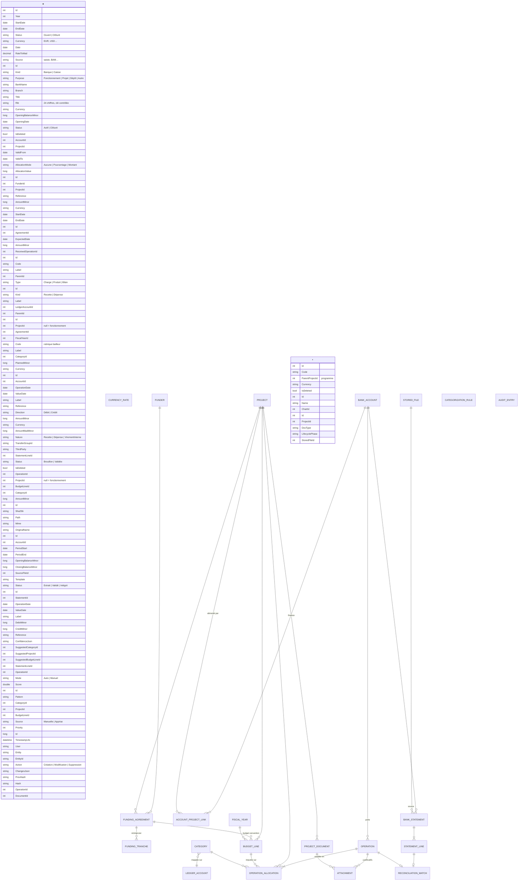

# AFMI Smart Admin 2.0 — Analyse de l'existant et plan d'implémentation

*Version 1 du document, rédigée le 10/11/2026 à partir du commit `8a80f58` (version 1.3.0).*

**Statut : validé le 10/11/2026.** Les recommandations des décisions D1 à D5 et des questions Q1, Q2, Q6 à Q9,
Q11, Q12 et Q14 sont retenues. Les questions Q3, Q4, Q5, Q10 et Q13 attendent des documents ou des réponses
de l'AFMI. Avancement : **Lots 1 à 8 livrés — version 2.0.0** (voir [CHANGELOG](../../CHANGELOG.md) et [ARCHITECTURE](ARCHITECTURE.md)).

Écarts entre ce plan et sa réalisation, à ce stade :

- **D1 :** les tables `projects` et `financial_transactions` de Smart Office sont reprises **à la demande**
  (Trésorerie → « Reprendre Smart Office 1.x »), en brouillons, sur un compte choisi par l'utilisateur. Les tables
  techniques du backend (agents, chaînes, paie) restent dans sa propre base.
- **Lot 2 :** les écrans Banque et Trésorerie sont en **WPF** et non en React, contrairement à la note de la section 7.
  Ils appellent directement les règles de `Core/Finance`, ce qui évite de les réécrire en Python. Le React reste
  prévu pour l'éditeur et l'écran de validation des relevés scannés.
- **D1 :** le mode WAL n'est pas activé, car incompatible avec les copies de fichier du Desktop (export,
  sauvegarde).
- **D1 :** les champs hérités (`BudgetGlobal`, `CostEntry`…) restent en `double`, mais en clair. Les flux réels
  utilisent les nouvelles opérations, en centimes.
- **Lot 7 (dépendances) :** aucune nouvelle bibliothèque. Word et Excel reposent sur python-docx et openpyxl, déjà
  présents ; les graphiques sont dessinés avec Pillow (pas de matplotlib). Le PDF est imprimé par **Microsoft Edge**,
  installé sur tout Windows 10/11, ou par Chrome/Chromium, en mode sans interface. **LibreOffice** est facultatif :
  s'il est installé, il produit le **PDF/A-2b** et des PDF avec notes en bas de page. Ni l'un ni l'autre n'est
  téléchargé par l'application.
- **Rôles (Lots 7 et 8) :** les rôles protègent toutes les écritures : l'API Smart Office (middleware) et
  l'application de bureau (contrôle dans `SaveChanges`, qui couvre aussi les écrans de la 1.3.0).
- **Lot 8 (installateur) :** Tesseract et la police Amiri sont téléchargés une fois à la construction
  (`prepare_third_party.ps1`), puis vérifiés par empreinte. LibreOffice n'est pas embarqué (taille : plus de
  300 Mo) : il reste facultatif, pour le PDF/A.
- **Lot 7 (sauvegardes) :** l'ancienne sauvegarde automatique du Desktop (copie du fichier ouvert, 5 exemplaires)
  est remplacée par `BackupService` : copie cohérente par l'API SQLite, fréquence et conservation paramétrables,
  restauration différée au démarrage.

---

## 0. Synthèse

L'application 1.3.0 repose sur **deux bases de données qui ne se parlent pas** :

- `database.db`, côté Desktop (EF Core) : projets, tâches, coûts, bailleurs, indicateurs, documents.
- `afmi_smartoffice.db`, côté SmartOffice (SQLAlchemy) : projets en double, transactions OCR, paie, agents.

Aucune des deux ne contient de **compte bancaire**, de **recette**, de **ligne budgétaire** ni de **plan de comptes**.
Les montants sont en `double`. Côté Desktop, ils sont chiffrés colonne par colonne avec une clé AES écrite dans le
code source, ce qui empêche tout calcul SQL (sommes, soldes) sans rien protéger réellement.

Avant de produire des rapports annuels consolidés, il faut donc **construire le socle financier**
(Lot 1) et **choisir une source unique de vérité**. Ce choix (décision D1), ainsi que les questions de la
section 6, conditionnent tout le reste. Je ne commence pas le Lot 1 avant vos réponses.

---

## 1. Cartographie de l'existant

### 1.1 Desktop (WPF .NET 9, EF Core 9 SQLite, CommunityToolkit.Mvvm, QuestPDF, PdfPig, WebView2)

| Entité | Champs utiles | Remarques |
|---|---|---|
| `Project` | Code, Name, Status, Priority, dates cible/réelles, `BudgetGlobal` (chiffré), `FunderId`, `ParentProjectId` (programme → sous-projets) | Un seul bailleur par projet. Pas de devise. |
| `ProjectTask` | Arborescence WBS, avancement, `Budget`/`Cost` (chiffrés), prédécesseurs (texte CSV) | Sert à l'EVM (`EvmService`). |
| `CostEntry` | `Category` (texte libre), fournisseur, `EstimatedCost`/`ActualCost` (chiffrés), date | Seule notion de dépense. Aucun lien avec un compte, une pièce ou une ligne budgétaire. |
| `Funder` | Nom, couleur, logo, mentions légales, en-tête, pied de page | Ébauche de charte graphique. Pas d'échéancier de versement. |
| `ProjectBaseline` | Référence de convention, subvention engagée, cofinancement, échéance de rapport, fréquence | Une seule échéance de rapport (pas de liste d'obligations). |
| `Indicator` | Nom, cible, valeur courante, unité | Pas de niveau (impact/effet/extrant), pas de valeur de référence, pas d'historique, pas de désagrégation. |
| `ActivityReport` / `ActivityReportPhoto` | Titre, date, lieu, nombre de participants, narratif, difficultés ; photos avec chemin et légende | Base de la galerie (4.5) : pas d'EXIF, pas de consentement, pas de crédit. |
| `ProjectDocument` | Catégorie, phase, tags, montant, dates, texte extrait, résumé, insights | Base de la GED (4.6). Phases différentes de celles demandées. |
| `AuditLog` | Entité, champ, ancienne/nouvelle valeur, horodatage, utilisateur | **`ProjectId` obligatoire et suppression en cascade** : le journal disparaît avec le projet et ne peut pas tracer une donnée hors projet. |
| `ReportHistory`, `WorkflowStep`, `ProjectTemplate`, `SmtpSettings`, `AiSettings` | — | `AiSettings` : Ollama, ou OpenAI/Gemini en cloud, avec une seule clé. |

**Gestion du schéma :** pas de migrations EF Core. `Database.EnsureCreated()` est suivi de `CREATE TABLE IF NOT EXISTS`
et d'`ALTER TABLE` dont les erreurs sont ignorées (`AppDbContext.EnsureDocumentColumnsExist`). Aucune sauvegarde avant
modification.

**Accès aux données :** `new AppDbContext()` est instancié directement à 49 endroits, sans injection de dépendances.
On compte 9 suppressions physiques (`Remove`, `RemoveRange`).

**Services réutilisables :** `ReportGeneratorService` et `ActivityReportGeneratorService` (PDF QuestPDF),
`EvmService`, `DocumentAnalysisService` (extraction PdfPig, classification par mots-clés, diagnostic de phase),
`SecretProtector` (DPAPI), `MailService` (SMTP), `SmartOfficeHostService`.
Les exports « Word » d'`ExportService` sont du **HTML enregistré en .doc**, pas du vrai .docx.

### 1.2 SmartOffice backend (FastAPI, SQLAlchemy, pdfplumber, PyMuPDF, python-docx, openpyxl)

| Élément | Contenu | Réutilisation en v2 |
|---|---|---|
| `ProjectModel` | Code, titre, bailleur (texte), budget total/consommé, devise, KPIs en JSON | **Doublon** du `Project` Desktop. À fusionner. |
| `FinancialTransactionModel` | Date, date de valeur, libellé, débit, crédit, catégorie, axe, `project_code` (texte), TVA, ICE, statut | Prototype des opérations bancaires. Pas de compte, pas de relevé parent, statut « Validated » par défaut (contraire à la règle « aucune intégration sans validation »). |
| `ocr_engine.py` | PDF natif (pdfplumber/PyMuPDF), PDF scanné ou image via IA vision (Gemini ou Ollama), détection de 7 banques par nom, RIB 24 chiffres (longueur seulement, **clé non contrôlée**), catégorisation par mots-clés | Base du pipeline 4.2. **Pas d'OCR local** : un relevé scanné exige une IA. Pas de prétraitement d'image, pas de score de confiance, pas de contrôle de soldes. |
| `exporters.py` | Word (python-docx) et Excel (openpyxl, valeurs seulement) | Base des exports 4.7. |
| `llm_router.py` | Gemini (httpx) et Ollama, repli heuristique | À étendre : Anthropic, OpenAI, Mistral, serveur compatible OpenAI, choix par tâche, plafond de coût. |
| `base_agent.py` + `orchestrator.py` | 4 agents configurables, chaînes d'agents, `ngo_profile.json` (mémoire institutionnelle) | Rédaction du rapport moral, assistant de l'éditeur. |
| Paie (`payroll_ma.py`, EDI 9421) | Salariés, bulletins, versements IR | Les salaires doivent devenir des dépenses affectées (masse salariale par projet). |
| `database.py` | `create_all` puis liste d'`ALTER` idempotents | Même fragilité que côté Desktop. |

31 tests pytest passent (vérifié dans cet environnement).

### 1.3 SmartOffice frontend (React 18, Vite 6, Tailwind)

9 vues, un client API, un contexte de langue arabe/français qui gère `dir="rtl"`. Il n'y a pas de routeur, pas de
bibliothèque d'éditeur ni de graphiques.

---

## 2. Risques de sécurité et de confidentialité relevés

| # | Constat | Gravité | Correction proposée |
|---|---|---|---|
| S1 | `EncryptionService` : la clé et l'IV AES sont **en dur dans le code** (`Desktop/Services/EncryptionService.cs:11-12`). L'IV est fixe et, en cas d'erreur, la valeur est stockée **en clair** sans alerte. Toute personne disposant du binaire déchiffre la base. | Élevée | Décision D2 |
| S2 | Le RIB, l'ICE et l'IF du profil institutionnel sont injectés dans **chaque prompt** (`base_agent.py:100`), y compris vers Gemini. | Élevée | Lot 1 : service de masquage appliqué à tout envoi externe. |
| S3 | L'API locale n'a **pas d'authentification**. Tout programme lancé par l'utilisateur peut lire et écrire. Ce n'était pas grave tant que la base ne contenait pas de données bancaires. | Moyenne → élevée en v2 | Lot 1 : jeton aléatoire par session, généré par le Desktop, transmis au backend et injecté dans le WebView2. |
| S4 | La clé Gemini côté backend vit en mémoire ou en variable d'environnement. Elle n'est ni chiffrée ni persistée de façon sûre. | Moyenne | Lot 1 : stockage DPAPI côté Python (via `ctypes`, sans dépendance), au même format `dpapi:` que `SecretProtector`. |
| S5 | `AuditLog` est effacé en cascade avec le projet, et un échec d'écriture est silencieux. | Moyenne (traçabilité) | Lot 1 : nouveau journal indépendant, en ajout seul, chaîné par empreinte (hash). |
| S6 | Suppressions physiques en cascade (projet → coûts, documents…). | Moyenne | Lot 1 : suppression logique pour toutes les données financières. |
| S7 | Le RIB et l'ICE du profil par défaut (`ngo_profile.json`) ont l'air réels et sont versionnés dans le dépôt. | À vérifier | Si ce sont de vraies coordonnées, les retirer du dépôt. |
| S8 | Les montants en `double` produisent des erreurs d'arrondi dans les sommes. | Moyenne (exactitude) | Lot 1 : montants en entiers (centimes) + code devise. |

---

## 3. Écarts entre l'existant et la demande

| Fonction demandée | Existant | Écart |
|---|---|---|
| 4.1 Multi-comptes, liaisons, virements, trésorerie, rapprochement | Rien (un seul RIB dans le profil) | **Total** |
| 4.2 Relevés scannés | OCR IA uniquement, sans prétraitement, confiance, contrôles ni écran de validation | **Important** : OCR local, gabarits par banque, contrôles, validation, apprentissage |
| 4.3 Rapport moral | Rapports PDF par projet, rapports d'activité, indicateurs simples | Consolidation multi-projets, GAR, bénéficiaires désagrégés, traçabilité des chiffres |
| 4.3 Rapport financier | `CostEntry` par projet, transactions OCR séparées | **Total** : recettes, plan de comptes, budget prévu/réalisé, CER, fonds dédiés, N-1 |
| 4.4 Éditeur de documents | Aucun | **Total** |
| 4.5 Photos | Photo + légende par rapport d'activité | EXIF, consentement, crédit, légende IA, galerie, mise en page automatique |
| 4.6 GED et cycle de vie | `ProjectDocument` + analyse par mots-clés | Phases à réaligner, obligations et échéances, frise, alertes, recherche plein texte et sémantique |
| 4.7 Exports | PDF QuestPDF, faux .doc HTML, Excel en valeurs | Vrai .docx fidèle, PDF/A, signets, Excel avec formules, paquets, nommage |
| 4.8 Paramètres | SMTP, IA (1 fournisseur), profil JSON | Panneau complet, fournisseurs par tâche, import/export, rôles, sauvegardes |
| Transverse : migrations, sauvegarde, audit, suppression logique, multi-devises | Absents | **Total** |

---

## 4. Décisions d'architecture proposées

### D1 — Source unique de vérité *(à valider)*

**Proposition :** une seule base, le `database.db` du Desktop, dont le **schéma est piloté uniquement par les migrations
EF Core**.

1. Créer une bibliothèque **`Core/` (net9.0, sans WPF)** qui contient les entités, l'`AppDbContext`, les migrations et
   les règles de calcul financier (soldes, rapprochement, contrôle RIB, virements, budget).
   - Elle est testable avec xUnit sur n'importe quel système, y compris en intégration continue Linux.
   - Le Desktop la référence. Les modèles existants y sont déplacés sans changer d'espace de noms public.
2. Le backend Python **lit et écrit les mêmes tables**, via des modèles SQLAlchemy **sans DDL** (pas de `create_all`
   sur ces tables). La base est ouverte en mode WAL pour les accès concurrents.
3. Les données propres au backend (agents, chaînes, paie) migrent dans la base unique lors du Lot 1, après sauvegarde.
   Les doublons `projects` et `financial_transactions` sont fusionnés avec un rapport de migration.
4. **Répartition des règles :**
   - côté .NET (xUnit) : calculs comptables et de trésorerie, rapprochement ;
   - côté Python (pytest) : OCR, extraction et analyse.

   Chaque règle a **une seule implémentation de référence**. Les rares calculs dont Python a aussi besoin (solde d'un
   relevé) sont réécrits à l'identique, et leur concordance est garantie par des **jeux de tests communs** (fichiers
   JSON d'entrées et de sorties attendues, exécutés par xUnit et par pytest). On évite ainsi un pont entre processus.

*Alternative écartée :* faire du backend Python le propriétaire des données financières, avec le Desktop qui
passe par l'API. Elle contredit l'exigence de migrations EF Core et rendrait le Desktop inutilisable si le backend ne
démarre pas.

### D2 — Protection des données au repos *(à valider)*

Le chiffrement actuel est illusoire (S1) et bloque les calculs SQL. Deux options :

- **(a) Recommandée pour le Lot 1.**
  - Montants en clair (entiers), migration de déchiffrement après sauvegarde.
  - Protection assurée par le profil Windows (`%LocalAppData%`) et BitLocker.
  - Les sauvegardes et exports de base sont **chiffrés par mot de passe** (AES-GCM, clé dérivée PBKDF2).
  - Les secrets restent en DPAPI.
- **(b)** Chiffrement de toute la base avec **SQLCipher**, clé protégée par DPAPI. C'est plus sûr en cas de vol du
  fichier, mais il faut ajouter `SQLitePCLRaw.bundle_e_sqlcipher` côté .NET et `sqlcipher3` côté Python (paquet à
  intégrer dans PyInstaller). Je ferais d'abord un essai technique d'une demi-journée pour vérifier les deux côtés.

### D3 — Éditeur de documents *(à valider)*

| Critère | **TipTap 2 (ProseMirror)** | Syncfusion Document Editor | CKEditor 5 |
|---|---|---|---|
| Licence | MIT (cœur). Extensions « Pro » payantes : commentaires, suivi des modifications | Propriétaire. Licence communauté gratuite sous conditions de revenus et de taille d'équipe | GPL ou commercial. Pagination, suivi des modifications, export Word payants |
| Pagination réelle, en-têtes et pieds pair/impair/première page | À construire (aperçu paginé et rendu exact à l'export) | Natif | Payant |
| Blocs dynamiques (tableau budgétaire, galerie…) | Très simple (nœuds personnalisés) | Possible, plus lourd | Possible |
| RTL et documents mixtes | Oui (attribut `dir` par paragraphe) | Oui | Oui |
| Format des données | JSON ouvert, maîtrisé par nous | Format SFDT propriétaire | HTML |
| Poids ajouté | ~300 Ko | Plusieurs Mo, plus un service de conversion | ~1 Mo |

**Recommandation : TipTap.** Le document est stocké en JSON. La **mise en page** (marges, en-têtes et pieds de page,
logos, mentions) ne se saisit pas dans le texte : elle vient de la **charte** et d'un panneau « Mise en page », est
prévisualisée page par page, puis rendue fidèlement par les exports .docx et PDF.

Le suivi des modifications et les commentaires seront développés par nous, en version simplifiée : marques
d'insertion et de suppression attribuées à un utilisateur, avec accepter ou refuser. Il n'y aura pas de co-édition en
temps réel.

*Limite assumée :* l'édition ne sera pas « pixel pour pixel » identique à Word pendant la frappe. Si vous voulez un
vrai Word dans l'application, Syncfusion est l'option. Il faut alors vérifier que l'AFMI est éligible à la licence
communauté.

### D4 — OCR local *(à valider)*

L'OCR actuel exige une IA (cloud ou Ollama). Proposition :

- **Tesseract 5**, Apache-2.0, langues fra, ara et eng. Il fournit les boîtes de mots et un **score de confiance par
  mot**, nécessaire pour surligner les champs douteux. Le binaire est livré avec l'installateur (environ +70 Mo).
- Prétraitement (redressement, contraste, binarisation) avec **`opencv-python-headless`** (environ 40 Mo). Cette
  dépendance lourde se justifie parce que le redressement fiable n'est pas faisable avec Pillow seul.
- L'IA multimodale reste une option, activée dans les paramètres.
- *Écarté :* PaddleOCR (trop lourd) et l'OCR intégré à Windows (pas de score de confiance).

### D5 — Autres choix techniques

- **Montants :** `long` en centimes + code devise ISO. Chaque opération en devise conserve sa contre-valeur en MAD et
  le taux daté utilisé.
- **Migrations :**
  1. Une migration de référence `Baseline_1_3_0` est marquée comme appliquée si les tables existent déjà
     (technique standard pour une base créée avec `EnsureCreated`).
  2. **Sauvegarde horodatée automatique** avant toute migration en attente.
  3. Chaque migration a un `Down()` testé.
  4. L'ancien code d'`ALTER` ad hoc est supprimé.
- **Graphiques :** Recharts côté React, rendus en images (SVG puis PNG) pour les exports.
- **Recherche :**
  - plein texte avec SQLite FTS5 (intégré, aucune dépendance) ;
  - sémantique avec des vecteurs stockés en BLOB et une recherche par force brute avec NumPy, suffisante pour
    quelques milliers de documents ;
  - vecteurs produits par Ollama (`nomic-embed-text`) ou par le fournisseur cloud choisi.
- **Exports :**
  - .docx avec python-docx, complété par des ajouts XML pour les notes de bas de page, `w:bidi` et le champ TOC ;
  - PDF avec QuestPDF côté Desktop (déjà présent : RTL, polices intégrées, signets). La prise en charge de PDF/A
    par QuestPDF sera vérifiée au Lot 7 ;
  - Excel avec openpyxl et de vraies formules.
- **Fournisseurs IA :** appels HTTP directs (httpx) pour Anthropic, OpenAI, Gemini, Mistral et les serveurs
  compatibles OpenAI (Ollama, LM Studio). Aucun SDK supplémentaire.

---

## 5. Schéma de données cible

Les nouvelles entités sont marquées ★, les entités existantes modifiées ◐.

**Règles portées par ce schéma :**

- **Solde d'un compte à la date d :**
  - formule : solde d'ouverture + Σ crédits − Σ débits, sur les opérations validées et non supprimées, avec une date
    d'opération ≤ d ;
  - une seule fonction, testée par xUnit, y compris pour les dates antérieures à l'ouverture et les comptes clôturés.
- **Virement interne :**
  - deux opérations (débit sur A, crédit sur B) partagent un `TransferGroupId` et ont la nature `VirementInterne` ;
  - elles comptent dans les soldes, mais **sont exclues** des agrégats de recettes et de dépenses ;
  - un virement non apparié est une anomalie bloquante.
- **Source unique :**
  - toute opération validée doit avoir des ventilations dont la somme est exactement égale à son montant ;
  - chaque ventilation désigne un projet ou le fonctionnement (`null`), une ligne budgétaire et une catégorie ;
  - les frais de fonctionnement peuvent être répartis sur plusieurs projets selon une clé paramétrée.
- **Multi-devises :** le montant d'origine est conservé avec sa contre-valeur en MAD, au taux daté le plus récent
  antérieur ou égal à la date de l'opération. Le taux n'est jamais inventé : s'il manque, la saisie est bloquée.
- **Contrôle du RIB marocain :** 24 chiffres (banque 3, ville 3, compte 16, clé 2). La clé est vérifiée par
  97 − ((banque‖ville‖compte × 100) mod 97). L'algorithme sera confirmé sur des RIB réels de l'AFMI avant d'être
  rendu bloquant ; en attendant, une clé invalide déclenche un simple avertissement.

**Entités des lots 4 à 7 :** elles seront détaillées au début de leur lot.

- **Lot 4 :** `CHART` (charte, avec héritage AFMI → bailleur → projet), `DOC_TEMPLATE`, `EDITOR_DOCUMENT`,
  `DOCUMENT_VERSION`, `DOC_COMMENT`, et `PHOTO` (fichier, date de prise de vue, lieu, GPS, légende, légende proposée
  par l'IA, crédit, consentement, activité).
- **Lot 5 :** `INDICATOR` ◐ (niveau, valeur de référence) et `INDICATOR_MEASUREMENT` (période, valeur, sexe, tranche
  d'âge, zone).
- **Lot 6 :** `REPORTING_OBLIGATION` et `MILESTONE`.
- **Lot 7 :** `SETTING` (clé, valeur JSON, secret oui/non) et `USER`/`ROLE` (si la réponse à Q9 l'exige).

---

## 6. Questions à trancher avant le Lot 1

Je n'invente aucune règle financière : ces points demandent votre réponse ou celle de votre expert-comptable.

| # | Question | Ma recommandation |
|---|---|---|
| Q1 | D1 : base unique pilotée par EF Core, avec bibliothèque `Core/` partagée ? | Oui |
| Q2 | **Rôle de l'application :** outil de **gestion** (comptabilité de trésorerie recettes/dépenses, rapports, export vers l'expert-comptable) ou **tenue de la comptabilité officielle** en partie double (journaux, grand livre, balance, bilan) ? | Outil de gestion pour la v2.0, avec export des écritures vers le logiciel du comptable. La partie double multiplie la charge et les responsabilités. |
| Q3 | **Référentiel comptable :** quel plan de comptes votre expert-comptable utilise-t-il (plan comptable spécifique aux associations adopté par le CNC, CGNC adapté, autre) ? Quel modèle de **compte d'emploi des ressources** ? Pouvez-vous fournir le plan de comptes, le dernier rapport financier approuvé en AG et un exemple de CER ? | Partir de vos documents réels. |
| Q4 | **Fonds dédiés et reports :** comment votre comptable traite-t-il une subvention reçue mais non consommée au 31/12 (fonds dédiés, produits constatés d'avance, simple report de solde par projet) ? Comptabilité d'engagement ou d'encaissement ? Exercice = année civile ? | À fixer avec le comptable. |
| Q5 | **Banques utilisées par l'AFMI**, et **2 à 3 relevés réels anonymisés par banque**, scannés et natifs, pour constituer `tests/fixtures/releves/`. Le seuil de 95 % n'a de sens que sur de vrais relevés : des relevés synthétiques ne prouveraient que le générateur. | Indispensable avant le Lot 3. |
| Q6 | D2 : protection des données, option (a) ou (b) ? | (a) au Lot 1, puis essai de (b) |
| Q7 | D3 : éditeur TipTap (ouvert, mise en page rendue à l'export) ou Syncfusion (Word-like, licence propriétaire) ? | TipTap |
| Q8 | D4 : Tesseract et OpenCV livrés dans l'installateur (environ +110 Mo) ? | Oui |
| Q9 | **Utilisateurs :** l'application reste-t-elle sur un seul poste ? Si oui, je propose un simple nom d'utilisateur pour le journal d'audit et je reporte les rôles après la 2.0. Le multi-poste avec une base SQLite partagée sur le réseau est risqué (corruption). | Un seul poste |
| Q10 | **Formats bailleurs prioritaires :** lesquels (UE, AFD, GIZ, INDH, FAO…) ? Avez-vous leurs gabarits de rapport financier ? | Commencer par 1 ou 2 bailleurs réels. |
| Q11 | **Taux de change :** saisie manuelle (cours de référence Bank Al-Maghrib) ou taux fixé par convention ? Les bailleurs en EUR imposent souvent le taux du jour de réception des fonds. | Taux paramétrable par convention, sinon taux saisi |
| Q12 | **Paie :** les salaires validés doivent-ils générer automatiquement des opérations de dépense, ventilées par projet selon le temps passé ? | Oui, avec validation |
| Q13 | S7 : le RIB et l'ICE dans `ngo_profile.json` sont-ils réels ? | Si oui, les retirer du dépôt. |
| Q14 | **Environnement de compilation** (voir section 8) | Intégration continue GitHub Actions sous Windows |

---

## 7. Plan d'implémentation par lots

Chaque lot se termine par : compilation et tests verts, `CHANGELOG.md`, mise à jour de `docs/`, liste des points à
valider, et un commit dédié.

### Lot 1 — Fondations
1. Créer `Core/` (net9.0) avec les entités, l'`AppDbContext` et les règles. Ajouter le projet de tests `Core.Tests`.
   Le Desktop référence `Core`.
2. Migrations EF Core :
   - migration de référence 1.3.0 ;
   - sauvegarde automatique avant migration ;
   - migration des montants (déchiffrement vers `long`, selon D2) ;
   - suppression de l'ancien code d'`ALTER` ad hoc.
3. Nouvelles entités du schéma de la section 5 : comptes, liaisons, opérations, ventilations, catégories, plan de
   comptes, lignes budgétaires, conventions et tranches, exercices, taux, fichiers.
4. Journal d'audit (`AUDIT_ENTRY`) branché sur `SaveChanges` par intercepteur, en ajout seul et chaîné. Suppression
   logique avec filtres globaux. `AuditLog` est conservé en lecture.
5. Unification des bases : modèles SQLAlchemy des tables EF, migration des données SmartOffice après sauvegarde,
   rapport de migration.
6. Sécurité : jeton d'API par session (S3), masquage avant envoi externe (S2), DPAPI côté Python (S4).
7. Paramètres de base : association, exercice, devise, langue, mode hors ligne IA.
8. Tests :
   - xUnit : solde à date, virement, ventilation, RIB, conversion de devise, audit ;
   - xUnit : migrations aller-retour (Up/Down) sur une copie d'une base 1.3.0 ;
   - pytest : masquage, jeton.

### Lot 2 — Banque
Écrans des comptes (WPF ou React, voir la note ci-dessous), virements internes, tableau de bord de trésorerie
(soldes, consolidé, prévision à 3, 6 et 12 mois à partir des tranches et du budget), alertes, rapprochement
automatique (montant exact, date ± N jours, similarité de libellé) et manuel, état de rapprochement exportable.

### Lot 3 — Relevés scannés
Pipeline : prétraitement → Tesseract → détection de la banque par gabarits JSON configurables → extraction
structurée → IA optionnelle. Contrôles de soldes, de doublons (empreinte du fichier et des lignes) et de continuité.
Écran de validation (image + tableau, faible confiance surlignée), catégorisation par règles, IA et apprentissage,
anomalies, archivage de la source. Mesure du taux d'extraction sur les relevés de Q5.

### Lot 4 — Éditeur, chartes, galerie
TipTap (ou l'option D3 retenue), styles, tableaux, sauts de page, notes, table des matières, champs, RTL. Chartes
avec héritage, modèles, blocs dynamiques, versions, commentaires, mode révision, assistant IA. Galerie photos avec
EXIF, consentement, légende IA à valider et grille automatique.

### Lot 5 — Rapports annuels
Assistant (exercice, périmètre, langue, modèle). Contrôles de cohérence (bloquants ou en avertissement).
- Rapport moral : données GAR et bénéficiaires, synthèse IA dont **chaque chiffre porte une référence à sa source**,
  et toute valeur non sourcée est signalée.
- Rapport financier : CER, recettes et dépenses, exécution budgétaire, trésorerie au 31/12, fonds dédiés,
  comparaison N-1, graphiques.

Le rapport s'ouvre dans l'éditeur.

### Lot 6 — GED et cycle de vie
Types et phases réalignés (identification → évaluation), classification, extraction des métadonnées et des
obligations, frise, alertes, FTS5 et recherche sémantique avec citations, alimentation de la mémoire
institutionnelle.

### Lot 7 — Exports et paramètres avancés
.docx fidèle, PDF (signets, PDF/A), Excel avec formules et une feuille par état, paquet annuel, nommage
configurable. Panneau de paramètres complet : IA par tâche, cinq fournisseurs, test de connexion, plafond de coût,
prompts modifiables, import/export JSON, sauvegardes planifiées, apparence.

### Lot 8 — Finalisation
Données de démonstration (3 projets, 3 comptes, 12 relevés), tests de bout en bout, performance, `GUIDE_UTILISATEUR.md`
avec captures, `ARCHITECTURE.md`, installateur, version 2.0.0.

**Note sur l'interface :** je propose de construire les **nouveaux écrans en React** (Smart Office), parce que
l'éditeur, l'écran de validation des relevés et les graphiques y sont nettement plus simples. Le Desktop WPF garde
ses écrans actuels et gagne une entrée de menu par module. Les deux lisent la même base (D1). Si vous préférez
la banque et la trésorerie en WPF natif, dites-le avant le Lot 2.

---

## 8. Contraintes de l'environnement de développement

- Dans cette session cloud, le SDK .NET **n'est pas installable** : `builds.dotnet.microsoft.com` est bloqué par la
  politique réseau. WPF ne s'exécute de toute façon que sous Windows. Je ne peux donc pas compiler ni tester le
  Desktop ici. Les tests Python, eux, tournent.
- Deux solutions, non exclusives :
  1. autoriser les hôtes de téléchargement .NET dans l'environnement. Je pourrais alors compiler et tester `Core/`
     (net9.0, sans WPF) ici ;
  2. **ajouter un workflow GitHub Actions `windows-latest`** qui compile la solution et lance xUnit et pytest à
     chaque push. C'est ma recommandation, car elle garantit le critère « code compilé et tests passés » à chaque lot.

---

## 9. Risques du projet

| Risque | Mitigation |
|---|---|
| Ampleur (8 lots, dont plusieurs « totaux ») | Livraison par lot, démontrable ; priorité au socle financier |
| Migration d'une base réelle chiffrée | Sauvegarde, migration testée sur une copie, rapport, retour arrière documenté |
| Taux de 95 % sur des relevés scannés de qualité variable | Gabarits par banque, mesure sur de vrais relevés, IA en option, validation humaine systématique |
| Règles comptables non confirmées | Questions Q2 à Q4 ; tout état réglementaire est paramétrable et marqué « à valider par l'expert-comptable » |
| Hallucinations de l'IA dans le rapport moral | Chiffres injectés depuis la base avec leur source ; contrôle automatique des nombres présents dans le texte généré |
