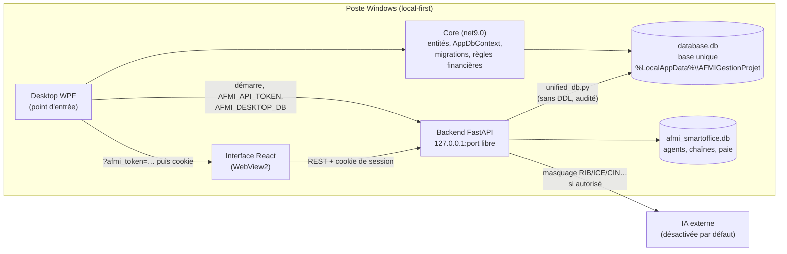
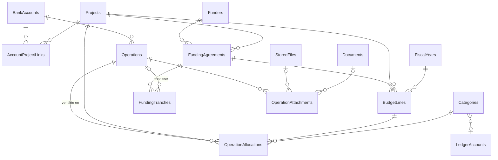

# AFMI Smart Admin 2.0 — Architecture

*Mis à jour à la fin de chaque lot. État actuel : **Lot 1 (fondations)**.*

## 1. Vue d'ensemble



| Composant | Rôle |
|---|---|
| `Core/` | **Seul propriétaire du schéma** de la base unique, via les migrations EF Core. Contient les règles financières de référence (`Core/Finance`) et le journal d'audit. |
| `Desktop/` | Interface WPF (MVVM, CommunityToolkit). Lance le backend et lui transmet le jeton de session, le chemin de la base et l'utilisateur à journaliser. |
| `SmartOffice/backend` | Agents IA, OCR, exports. Lit et écrit la base unique sans jamais modifier sa structure (`backend/core/unified_db.py`). Ses propres tables techniques restent dans `afmi_smartoffice.db`. |
| `SmartOffice/frontend` | Interface React affichée dans le WebView2. Les nouveaux écrans de la v2 y seront construits. |

## 2. Base de données

### 2.1 Migrations

| Migration | Contenu |
|---|---|
| `Baseline_1_3_0` | Schéma de la version 1.3.0. |
| `LegacyAmountsInClear` | Colonnes de montants hérités passées de TEXT (chiffré) à REAL. |
| `DecryptLegacyAmounts` | Migration de données : déchiffrement des montants hérités par la fonction SQL `afmi_legacy_amount`, enregistrée par `DatabaseMigrator`. |
| `FinanceFoundation` | Tables financières, paramètres, journal d'audit et ses déclencheurs. Ajoute la suppression logique (`IsDeleted`) aux projets et aux dépenses. |

**Démarrage** (`DatabaseMigrator.EnsureUpToDate`, exécuté une fois par processus et par base) :

1. Base antérieure aux migrations (table `Projects` présente, sans `__EFMigrationsHistory`) : elle est complétée
   par `LegacySchemaUpgrader`, puis `Baseline_1_3_0` est inscrite comme appliquée.
2. Si des migrations sont en attente, la base est sauvegardée dans `backups/<base>_<horodatage>_avant_<migration>.db`.
3. Les migrations sont appliquées. Chaque migration a son `Down()`, testé par un aller-retour complet
   (`MigrationTests`).

**Ajouter une migration :**

```bash
dotnet ef migrations add <Nom> --project Core -o Data/Migrations
```

```bash
dotnet ef migrations script --project Core -o SmartOffice/tests/fixtures/unified_schema.sql
```

Le test `PythonSchemaFixture_IsUpToDate` échoue si le script n'a pas été régénéré.

### 2.2 Modèle financier

Le schéma cible complet est décrit dans [ANALYSE.md § 5](ANALYSE.md#5-schéma-de-données-cible). Implémenté au Lot 1 :



**Conventions :**

- **Montants :** `long` en centimes (`…Minor`) avec un code devise ISO.
  - Une opération porte son montant dans la devise du compte, le taux appliqué et sa contre-valeur MAD, figés à
    l'enregistrement.
  - Les taux sont des `decimal`, stockés en TEXT par SQLite.
- **Énumérations :** stockées en texte (`Income`, `Debit`…), lisibles par le backend et dans les exports.
- **Dates :** `DateOnly` pour les dates comptables, stockées en TEXT au format `yyyy-MM-dd` ; `DateTime` UTC pour
  les horodatages.
- **Suppression logique :** l'interface `ISoftDeletable` et un filtre global masquent les lignes supprimées. Le
  backend doit filtrer `IsDeleted = 0` lui-même.
- **Clés étrangères :** `Restrict` partout dans le domaine financier. Aucune cascade ne peut effacer une écriture.

### 2.3 Règles financières (`Core/Finance`)

| Règle | Implémentation | Tests |
|---|---|---|
| Solde à la date d = ouverture + crédits − débits (opérations validées, non supprimées, date ≤ d) ; 0 avant l'ouverture | `FinanceService.GetBalanceMinor` | `FinanceServiceTests` |
| Virement interne : deux jambes liées par `TransferGroupId`, exclues des recettes et des dépenses ; jambe orpheline détectée | `CreateInternalTransfer`, `GetIncomeAndExpenses`, `FindUnpairedTransfers` | idem |
| Opération validée = entièrement ventilée sur des lignes budgétaires du bon projet, dans la devise du compte, dans la période d'ouverture du compte | `OperationValidator` | `FinanceRuleTests` |
| Taux : le plus récent ≤ date ; absent = blocage | `CurrencyConverter` | idem |
| Répartition sans perte de centime (plus fort reste) | `AllocationSplitter` | vecteurs partagés |
| Clé RIB : 97 − ((22 chiffres × 100) mod 97) | `Rib` (C#) et `backend/tools/rib.py` | vecteurs partagés |

### 2.4 Journal d'audit

- **Écriture :** `AppDbContext.SaveChanges(Async)`.
  1. Détection des changements, puis conversion des suppressions en suppressions logiques.
  2. Enregistrement des données.
  3. Écriture des entrées d'audit **dans la même transaction**.
- **Contenu d'une entrée :** utilisateur (`AuditContext`), poste, entité, identifiant, action, et JSON des champs
  modifiés (ancienne et nouvelle valeur). Les secrets sont remplacés par `***` et les textes longs résumés.
- **Ajout seul :** l'application refuse toute modification ou suppression d'une entrée, et les déclencheurs SQLite
  `TR_AuditEntries_NoUpdate` et `TR_AuditEntries_NoDelete` la bloquent aussi.
- **Chaînage :** `Hash = SHA-256(PreviousHash ␟ horodatage ␟ utilisateur ␟ poste ␟ entité ␟ id ␟ action ␟ changements)`.
  - `FindFirstTamperedAuditEntry()` (C#) et `find_first_tampered_audit_entry()` (Python) vérifient la chaîne ;
  - le format est commun aux deux langages (`SharedTestCases/audit_hash.json`) ;
  - le backend écrit ses entrées avec `unified_db.append_audit`.
- **Ancien journal :** l'ancien `AuditLog` (par projet) est conservé en lecture.

## 3. Sécurité et confidentialité

| Sujet | Mesure |
|---|---|
| Accès à l'API locale | Contrôle d'hôte et d'origine (déjà en 1.3.0), plus **jeton de session**. `AFMI_API_TOKEN` est généré par le Desktop. La page est ouverte avec `?afmi_token=`, puis le backend pose un cookie `HttpOnly; SameSite=Strict`. Les appels programmatiques utilisent l'en-tête `X-AFMI-Token`. Sans jeton configuré (développement web), l'API reste ouverte aux pages locales. |
| Secrets | DPAPI (compte Windows) des deux côtés, au même format `dpapi:` et avec la même entropie. Hors Windows, aucun secret n'est stocké. |
| IA externe | Désactivée par défaut (`ai.offline_mode`). Une fois activée, le masquage (`ai.mask_sensitive_data`, actif par défaut) remplace RIB, IBAN, ICE, IF, CIN, n° CNSS et salaires par des marqueurs (`backend/core/privacy.py`). Les images ne sont jamais envoyées quand le masquage est actif. |
| Données au repos | Montants en clair (décision D2-a). Protection par le profil Windows et BitLocker. Le chiffrement de la base entière (SQLCipher) reste à évaluer. |
| Isolation des tests | `AFMI_DESKTOP_DB` pointe vers une base jetable dans `Desktop.Tests`, `Core.Tests` et `pytest`. |

## 4. Variables d'environnement

| Variable | Fixée par | Rôle |
|---|---|---|
| `AFMI_DESKTOP_DB` | Desktop → backend ; tests | Chemin de la base unique |
| `AFMI_API_TOKEN` | Desktop → backend | Jeton de session de l'API |
| `AFMI_AUDIT_USER` | Desktop → backend | Utilisateur inscrit dans le journal d'audit |
| `AFMI_DATA_DIR` | Desktop → backend (version installée) | Données propres au backend |

## 5. Tests et intégration continue

| Suite | Commande | Contenu |
|---|---|---|
| `Core.Tests` (xUnit, multiplateforme) | `dotnet test Core.Tests` | Migrations (base neuve, base 1.3.0 chiffrée, échec atomique, aller-retour), règles financières, audit, suppression logique, paramètres, vecteurs partagés |
| `Desktop.Tests` (xUnit, Windows) | `dotnet test Desktop.Tests` | Tests existants de la 1.3.0, désormais sur une base jetable |
| Backend (pytest) | `python -m pytest SmartOffice/tests` | Tests existants, plus confidentialité, jeton de session, base unique et vecteurs partagés |

Le workflow `.github/workflows/ci.yml` exécute l'ensemble sous Windows à chaque push.
