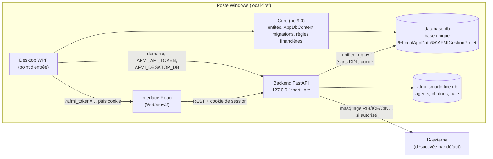
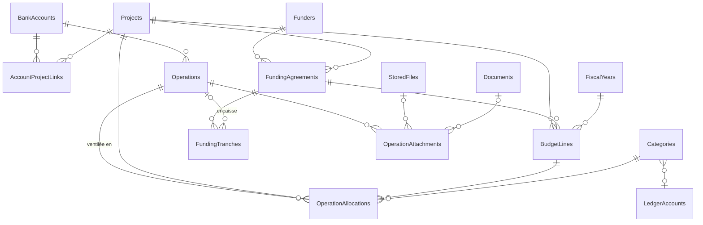

# AFMI Smart Admin 2.0 — Architecture

*Mis à jour à la fin de chaque lot. État actuel : **Lot 6 (GED et cycle de vie)**.*

## 1. Vue d'ensemble



| Composant | Rôle |
|---|---|
| `Core/` | **Seul propriétaire du schéma** de la base unique, via les migrations EF Core. Contient les règles financières de référence (`Core/Finance`) et le journal d'audit. |
| `Desktop/` | Interface WPF (MVVM, CommunityToolkit). Lance le backend et lui transmet le jeton de session, le chemin de la base et l'utilisateur à journaliser. |
| `SmartOffice/backend` | Agents IA, OCR, exports. Lit et écrit la base unique sans jamais modifier sa structure (`backend/core/unified_db.py`). Ses propres tables techniques restent dans `afmi_smartoffice.db`. |
| `SmartOffice/frontend` | Interface React affichée dans le WebView2. Les nouveaux écrans de la v2 y seront construits. |

## 2. Base de données

### 2.1 Migrations

| Migration | Contenu |
|---|---|
| `Baseline_1_3_0` | Schéma de la version 1.3.0. |
| `LegacyAmountsInClear` | Colonnes de montants hérités passées de TEXT (chiffré) à REAL. |
| `DecryptLegacyAmounts` | Migration de données : déchiffrement des montants hérités par la fonction SQL `afmi_legacy_amount`, enregistrée par `DatabaseMigrator`. |
| `FinanceFoundation` | Tables financières, paramètres, journal d'audit et ses déclencheurs. Ajoute la suppression logique (`IsDeleted`) aux projets et aux dépenses. |
| `BankingAndReconciliation` | Relevés (`BankStatements`), lignes (`StatementLines`), rapprochements (`ReconciliationMatches`, un pour un, index uniques), seuil « solde bas », catégories de dépenses génériques. |

**Démarrage** (`DatabaseMigrator.EnsureUpToDate`, exécuté une fois par processus et par base) :

1. Base antérieure aux migrations (table `Projects` présente, sans `__EFMigrationsHistory`) : elle est complétée
   par `LegacySchemaUpgrader`, puis `Baseline_1_3_0` est inscrite comme appliquée.
2. Si des migrations sont en attente, la base est sauvegardée dans `backups/<base>_<horodatage>_avant_<migration>.db`.
3. Les migrations sont appliquées. Chaque migration a son `Down()`, testé par un aller-retour complet
   (`MigrationTests`).

**Ajouter une migration :**

```bash
dotnet ef migrations add <Nom> --project Core -o Data/Migrations
```

```bash
dotnet ef migrations script --project Core -o SmartOffice/tests/fixtures/unified_schema.sql
```

Le test `PythonSchemaFixture_IsUpToDate` échoue si le script n'a pas été régénéré.

### 2.2 Modèle financier

Le schéma cible complet est décrit dans [ANALYSE.md § 5](ANALYSE.md#5-schéma-de-données-cible). Implémenté au Lot 1 :



**Conventions :**

- **Montants :** `long` en centimes (`…Minor`) avec un code devise ISO.
  - Une opération porte son montant dans la devise du compte, le taux appliqué et sa contre-valeur MAD, figés à
    l'enregistrement.
  - Les taux sont des `decimal`, stockés en TEXT par SQLite.
- **Énumérations :** stockées en texte (`Income`, `Debit`…), lisibles par le backend et dans les exports.
- **Dates :** `DateOnly` pour les dates comptables, stockées en TEXT au format `yyyy-MM-dd` ; `DateTime` UTC pour
  les horodatages.
- **Suppression logique :** l'interface `ISoftDeletable` et un filtre global masquent les lignes supprimées. Le
  backend doit filtrer `IsDeleted = 0` lui-même.
- **Clés étrangères :** `Restrict` partout dans le domaine financier. Aucune cascade ne peut effacer une écriture.

### 2.3 Règles financières (`Core/Finance`)

| Règle | Implémentation | Tests |
|---|---|---|
| Solde à la date d = ouverture + crédits − débits (opérations validées, non supprimées, date ≤ d) ; 0 avant l'ouverture | `FinanceService.GetBalanceMinor` | `FinanceServiceTests` |
| Virement interne : deux jambes liées par `TransferGroupId`, exclues des recettes et des dépenses ; jambe orpheline détectée | `CreateInternalTransfer`, `GetIncomeAndExpenses`, `FindUnpairedTransfers` | idem |
| Opération validée = entièrement ventilée sur des lignes budgétaires du bon projet, dans la devise du compte, dans la période d'ouverture du compte | `OperationValidator` | `FinanceRuleTests` |
| Taux : le plus récent ≤ date ; absent = blocage | `CurrencyConverter` | idem |
| Répartition sans perte de centime (plus fort reste) | `AllocationSplitter` | vecteurs partagés |
| Clé RIB : 97 − ((22 chiffres × 100) mod 97) | `Rib` (C#) et `backend/tools/rib.py` | vecteurs partagés |

### 2.4 Journal d'audit

- **Écriture :** `AppDbContext.SaveChanges(Async)`.
  1. Détection des changements, puis conversion des suppressions en suppressions logiques.
  2. Enregistrement des données.
  3. Écriture des entrées d'audit **dans la même transaction**.
- **Contenu d'une entrée :** utilisateur (`AuditContext`), poste, entité, identifiant, action, et JSON des champs
  modifiés (ancienne et nouvelle valeur). Les secrets sont remplacés par `***` et les textes longs résumés.
- **Ajout seul :** l'application refuse toute modification ou suppression d'une entrée, et les déclencheurs SQLite
  `TR_AuditEntries_NoUpdate` et `TR_AuditEntries_NoDelete` la bloquent aussi.
- **Chaînage :** `Hash = SHA-256(PreviousHash ␟ horodatage ␟ utilisateur ␟ poste ␟ entité ␟ id ␟ action ␟ changements)`.
  - `FindFirstTamperedAuditEntry()` (C#) et `find_first_tampered_audit_entry()` (Python) vérifient la chaîne ;
  - le format est commun aux deux langages (`SharedTestCases/audit_hash.json`) ;
  - le backend écrit ses entrées avec `unified_db.append_audit`.
- **Ancien journal :** l'ancien `AuditLog` (par projet) est conservé en lecture.

### 2.5 Trésorerie et rapprochement (Lot 2)

| Service (`Core/Finance`) | Rôle |
|---|---|
| `AccountService` | Comptes : contrôle du RIB, clôture si solde nul. Liaisons avec contrôle des chevauchements et du total ≤ 100 %. Proposition d'imputation à partir des liaisons. |
| `ReconciliationService` | Contrôles d'un relevé (soldes, doublon, continuité). Rapprochement automatique : montant signé égal, ± N jours, score 60 % date + 40 % libellé, cas ambigus exclus. Rapprochement manuel. État de rapprochement. |
| `TreasuryForecastService` | Prévision mensuelle en MAD (tranches attendues, reste à consommer des lignes budgétaires) et réalisé par ligne budgétaire (quote-part MAD de chaque ventilation, nette des avoirs). |
| `TreasuryAlertService` | Alertes : solde négatif ou bas, inactivité, écart de rapprochement, virement orphelin, tranche en retard, brouillons. |
| `StatementCsvImporter` | Lecture des exports CSV bancaires (détection du séparateur et des colonnes, formats FR et ISO). |
| `LegacySmartOfficeImporter` | Reprise idempotente de `afmi_smartoffice.db`, lue en lecture seule, en brouillons. |

**Formule de l'état de rapprochement :**

- solde bancaire rectifié = solde du relevé + opérations comptabilisées non passées en banque − mouvements
  bancaires non comptabilisés ;
- écart inexpliqué = solde comptable à la fin du relevé − solde bancaire rectifié ;
- les opérations antérieures au premier relevé importé sont réputées déjà prises en compte dans son solde initial.

**Écran WPF** (`Desktop/Views/TreasuryView.xaml`, `Desktop/ViewModels/Treasury/`) : cinq onglets (Comptes, Opérations
et virements, Budget et conventions, Rapprochement bancaire, Prévisions et alertes). Le ViewModel ne contient aucune
règle financière : chaque action appelle un service de `Core` et affiche son refus éventuel. L'état de rapprochement
est exporté par `Desktop/Services/ReconciliationExportService.cs` (QuestPDF et CSV).

### 2.6 Lecture des relevés (Lot 3)

```mermaid
flowchart LR
    F["Fichier<br/>PDF / JPG / PNG / CSV / XLSX"] --> T{"Type"}
    T -- "PDF avec texte" --> N["Mots + positions<br/>(PyMuPDF, confiance 100)"]
    T -- "scan / photo" --> P["Prétraitement OpenCV<br/>redressement, débruitage, contraste"] --> O["Tesseract<br/>mots + boîtes + confiance"]
    T -- "CSV / Excel" --> TAB["Lecture tabulaire"]
    N --> X["Extraction<br/>gabarit banque, colonnes, lignes,<br/>soldes, période, RIB"]
    O --> X
    X --> B{"Soldes<br/>équilibrés ?"}
    B -- non --> S2["Seconde lecture (binarisée)<br/>correction unique, surlignée"] --> AI{"IA cochée ?"}
    AI -- oui --> IA["Extraction IA<br/>(règles de confidentialité)"]
    B -- oui --> DB
    AI -- non --> DB
    IA --> DB
    TAB --> DB["Brouillon : BankStatements + StatementLines<br/>+ fichier archivé (SHA-256) + suggestions"]
    DB --> V["Écran de validation (React)<br/>image ↔ tableau, corrections, apprentissage"]
    V -- "Valider (contrôles bloquants)" --> I["Intégrer → Operations en brouillon"]
    I --> TR["Trésorerie (WPF) : ventiler, valider, rapprocher"]
```



| Module (`SmartOffice/backend/tools/statements/`) | Rôle |
|---|---|
| `preprocess.py` | Redressement (variance du profil de projection, recherche grossière puis fine), débruitage, CLAHE. Binarisation seulement pour la seconde lecture : Tesseract lit mieux les scans flous en niveaux de gris. |
| `ocr.py` | Tesseract en ligne de commande (sortie TSV). L'exécutable est cherché dans `AFMI_TESSERACT`, puis dans un dossier `tesseract/` livré avec l'application, puis dans le PATH. |
| `templates.py` + `config/bank_templates.json` | Gabarits de banques (mots d'identification, libellés des soldes) et mots d'en-tête des colonnes. Modifiables sans programmation ; une copie dans le dossier de configuration de l'utilisateur est prioritaire. |
| `extract.py` | Reconstruction en lignes et colonnes, confiance par champ (date et montants : minimum ; libellé : moyenne). |
| `pipeline.py` | Orchestration par type de fichier, images des pages pour l'écran, seconde lecture. |
| `categorize.py` | Règles manuelles, apprises, puis de base ; propositions de projet et de ligne budgétaire ; apprentissage. |
| `store.py` | Archivage, brouillon, corrections, contrôles, anomalies, validation, intégration (journalisées). |
| `ai_extract.py` | Recours IA, retenu seulement si les soldes s'équilibrent. |

API : `/api/statements` (`context`, `upload`, `{id}`, `{id}/pages/{n}`, `PUT {id}`, `{id}/validate`, `{id}/integrate`,
`DELETE {id}`). Les fichiers sources et les images des pages sont archivés dans `<données Smart Office>/archives/releves/`.

**Répartition des règles :** le backend ne crée que des opérations **en brouillon** (contrôles de base : compte actif,
date ≥ ouverture, devise du compte, taux daté). La validation d'une opération, avec ventilation exacte sur des lignes
budgétaires cohérentes, reste dans `Core/Finance`. Aucune règle financière n'est dupliquée en Python.

### 2.7 Éditeur, chartes et photos (Lot 4)

**Données** (migration `EditorChartsAndPhotos`) :

| Table | Contenu |
|---|---|
| `GraphicCharts` | Charte : portée Association, Funder ou Project (contrainte de cohérence), `StyleJson` partiel |
| `DocumentTemplates` | Modèles (contenu TipTap JSON, mise en page, partage) |
| `EditorDocuments` | Documents : projet, bailleur, langue, contenu, mise en page propre, version courante |
| `DocumentVersions` | Instantanés numérotés et restaurables |
| `DocumentComments` | Commentaires ancrés par la marque `comment` portant le même identifiant |
| `Photos` | Fichier archivé, EXIF, activité liée, légende, légende proposée, crédit, consentement |

**Charte effective** (`backend/tools/editor/charts.py`) : défauts ← charte de l'association ← fiche du bailleur
(couleur, logo, mentions, textes) ← charte du bailleur ← charte du projet ← mise en page propre au document.
- Dictionnaires : fusionnés clé par clé.
- Logos : remplacés position par position.
- Mentions : cumulées sans doublon.

**Éditeur** (`SmartOffice/frontend/src/editor/`) :
- TipTap (ProseMirror) et extensions propres (`extensions.js`) :
  - `FontSize`, `TextDirection`, `ShadedTableCell` ;
  - `PageBreak`, `Columns`, `Footnote`, `TableOfContents`, `Field` ;
  - `DynamicBlock` (vue React qui interroge `/api/editor/blocks/{kind}`) ;
  - marques `comment`, `insertion` et `deletion`, et le greffon de révision `TrackChanges`.
- Les paramètres d'un bloc dynamique sont stockés dans le document ; ses chiffres sont recalculés depuis la base et
  ne sont jamais figés dans le texte.
- `print.js` produit l'HTML imprimable :
  - copie du rendu de l'éditeur (blocs compris), règles `@page` (boîtes de marge `:first`, `:left`), notes en fin de
    document ;
  - CSS de la charte commun à l'écran et à l'impression (`chartCss`).

**API** :
- `/api/charts` et `/api/charts/effective` ;
- `/api/files/images` (seuls les fichiers archivés de type image sont servis, jamais un chemin libre) ;
- `/api/funders/{id}/logo` ;
- `/api/templates`, `/api/documents` (versions, commentaires) ;
- `/api/editor/blocks/{budget|indicators|activities|chart|gallery}`, `/api/editor/fields`, `/api/editor/assistant` ;
- `/api/photos` (import, image allégée, mise à jour, légende proposée).

### 2.8 Rapports annuels (Lot 5)

| Module (`SmartOffice/backend/tools/reports/`) | Rôle |
|---|---|
| `context.py` | Exercice : table `FiscalYears`, sinon mois de début du paramètre `association.fiscal_year_start_month`. Périmètre : association, programme (avec ses sous-projets récursivement), projet ou bailleur (projets financés ou sous convention), et comptes liés. Présentation des états : `config/financial_report_layout.json`. |
| `finance.py` | Ventilations des opérations validées de la période. La contre-valeur MAD est répartie au plus fort reste (`split_minor`, identique à `AllocationSplitter`). Calcul du compte d'emploi des ressources, de la matrice nature × projet, de l'exécution budgétaire (par projet ou par bailleur), de la trésorerie avec l'état de rapprochement (même formule que `ReconciliationService`), des reports par convention, de la comparaison N-1 et des graphiques. |
| `moral.py` | Projets actifs sur l'exercice (dates, activités ou opérations), activités, indicateurs (cumul des mesures selon le mode, désagrégations), bénéficiaires, partenaires, faits chiffrés et synthèse déterministe trilingue. |
| `checks.py` | Contrôles de cohérence, avec leur niveau tiré de la configuration. |
| `generator.py` | Construction du document de l'éditeur : titres, textes et blocs `dynamicBlock` de type `annual`. Le RTL est appliqué aux paragraphes arabes ; la synthèse IA est facultative. |
| `i18n.py` | Libellés en français, arabe et anglais. |

**Concordance .NET / Python** : `SharedTestCases/annual_scenario.json` est exécuté par `AnnualScenarioTests` (C#) et
`test_lot5_reports.py`. Les totaux de recettes et de dépenses, les soldes et l'écart de rapprochement doivent être
identiques.

**API** :
- `/api/reports/context`, `/api/reports/checks` ;
- `/api/reports/generate` (409 avec la liste des contrôles en cas de blocage) ;
- `/api/reports/table/{cer|income_expense|budget_project|budget_funder|treasury|carry_forward|comparison|charts|activities|indicators|beneficiaries}` ;
- `/api/indicators` et leurs mesures ;
- `/api/photos/import-legacy`.

### 2.9 GED et cycle de vie (Lot 6)

**Données** (migration `DocumentManagement`) :
- `Documents` (table de l'application de bureau) : `DocType`, `LifecyclePhase`, `ClassificationConfidence`,
  `MetadataJson`, `StoredFileId`, `Language`, `IndexedAtUtc`, suppression logique ;
- `ReportingObligations` (avec `SourceExcerpt` pour la traçabilité, et `DeliveredDocumentId`) ;
- `ProjectMilestones` ;
- `DocumentChunks` (passages d'environ 900 caractères, vecteur float32 facultatif) et table virtuelle FTS5
  `DocumentChunksFts`, tenue à jour par déclencheurs.

| Module (`SmartOffice/backend/tools/ged/`) | Rôle |
|---|---|
| `textract.py` | Texte par page : PDF natif, OCR des pages scannées (pipeline du Lot 3), docx, xlsx, texte, images. |
| `analyze.py` | Classification par mots-clés pondérés (titre ×3), métadonnées, échéances de rapports (dates explicites ou périodicité + délai), langue. |
| `index.py` | Découpage, index FTS5, embeddings (`llm_router.embed` : Ollama, puis Gemini si autorisé), recherche plein texte (requête en ET, puis en OU), sémantique (cosinus) et hybride (fusion par rang réciproque). |
| `qa.py` | Questions-réponses avec citations ; réponse extractive sans modèle. |
| `lifecycle.py` | Phase atteinte, documents attendus, frise, alertes. |
| `service.py` | Import, mise à jour, suppression, analyse de l'existant, obligations et jalons. |

Configuration : `config/lifecycle_config.json` (phases, types et mots-clés, documents attendus, seuils d'alerte).

API : `/api/ged/{config, documents, documents/{id}/file, reindex, obligations, milestones, timeline/{id}, alerts, search, ask}`.

### 2.10 Exports et paramètres avancés (Lot 7)

**Exports** (`SmartOffice/backend/tools/exports/`) — un document de l'éditeur est d'abord *préparé*, puis rendu :

| Module | Rôle |
|---|---|
| `resolve.py` | Relit le document enregistré. Recalcule chaque bloc dynamique depuis la base en nœuds neutres (`x-table`, `x-bars`, `x-pies`, `x-gallery`, `x-note`). Remplit les champs et garde la version finale (révisions acceptées, commentaires retirés). Calcule la charte effective et la liste des titres. Les images distantes ne sont jamais téléchargées. |
| `docx_writer.py` | Word natif : styles Titre 1 à 3, champ TOC, vraie partie `footnotes.xml`, en-têtes et pieds de page (première page, paires et impaires, champs PAGE et NUMPAGES), tableaux (en-tête répété, cellules fusionnées, trames), RTL (`w:bidi`, `w:rtl`, `w:bidiVisual`). Une passe `normalize` remet les propriétés dans l'ordre du schéma OOXML. |
| `html_writer.py` | HTML autonome (images en data URI), même présentation que `print.js` (boîtes de marge `@page`). |
| `graphics.py` | Barres et camemberts en SVG (HTML) ou en PNG 200 dpi (Word) ; texte arabe mis en forme par Pillow et raqm. |
| `pdf.py` | Moteur « navigateur » (Edge/Chrome/Chromium sans interface, `--print-to-pdf`, signets) ou « LibreOffice » (docx → PDF, PDF/A-2b). Ajoute ensuite les métadonnées (titre, auteur, `/Lang`) et des signets reconstruits à partir des titres. |
| `xlsx_writer.py` | États financiers (une feuille par état) avec formules pour les sous-totaux, totaux, écarts, taux et résultats. Une formule n'est écrite que si elle redonne exactement le montant de l'application. Feuilles « Ventilations » et « Contrôles » (SOMME.SI.ENS, écart attendu 0). Classeur des opérations par compte, avec solde progressif en formule. État de rapprochement. |
| `naming.py` | Modèles `exports.naming.report` et `exports.naming.document` (variables {org} {type} {year} {lang} {title} {project} {date}). |
| `service.py` | Façade : export d'un document ou d'un état, dossier annuel ZIP (rapports Word et PDF, états Excel, annexes de la GED, PDF complet fusionné avec signets par partie, empreintes SHA-256). Chaque export est journalisé dans l'audit, avec l'empreinte du fichier. |

API : `/api/exports/{engines, naming-preview, document/{id}?format=docx|pdf&pdfa=, statements, operations, reconciliation/{id}, annual-package}`.

**Paramètres** (`SmartOffice/backend/core/`) :

| Module | Rôle |
|---|---|
| `settings_registry.py` | Registre unique des paramètres : section, type, valeur par défaut, bornes, aide. Il sert à la fois à l'écran, à la validation (tout ou rien), à la recherche, à l'import et l'export JSON (secrets exclus) et au retour aux valeurs par défaut (suppression de la ligne `AppSettings`, tracée dans l'audit). |
| `config_files.py` | `financial_report_layout`, `lifecycle_config` et `bank_templates`. La version personnalisée est validée, écrite dans le dossier de données de l'utilisateur, avec une copie datée de la précédente. Le fichier livré n'est jamais modifié. |
| `ai_config.py`, `ai_providers.py` | IA par tâche : rédaction, rapports, extraction, questions sur la GED, légendes. Fournisseurs : Anthropic, OpenAI, Gemini, Mistral, Ollama, serveur compatible OpenAI ou moteur local. Clés chiffrées par DPAPI (`ai.keys.*`), prompts modifiables (`ai.prompts.*`), consommation mensuelle (`ai.usage.AAAA-MM`) et plafond de coût. `llm_router.generate_with_meta(task=…)` essaie d'abord le fournisseur de la tâche, puis la chaîne locale. |
| `roles.py` | Rôles Administrateur, Comptable, Chargé de projet et Lecteur. Le middleware `role_guard` filtre les écritures selon la zone de l'URL. Liste vide : tous les droits. |
| `backups.py` | « Sauvegarder maintenant », liste et restauration programmée (`restore.pending`). Format identique à `Core/Services/BackupService.cs`, qui fait les sauvegardes planifiées (démarrage, puis toutes les heures) et applique la restauration au démarrage, avant EF Core, après une sauvegarde de sécurité. |
| `smtp.py` | Table `SmtpSettings` partagée (mot de passe DPAPI) et e-mail de test (STARTTLS ou SSL). |

Paramètres lus ailleurs :
- `bank.reconciliation_tolerance_days` : écran Trésorerie, doublons et justificatifs des relevés ;
- `accounting.receipt_threshold_mad` : anomalies des relevés et contrôle MISSING_RECEIPT des rapports ;
- `bank.fee_alert_min_mad` et `accounting.auto_learn_rules` : relevés ;
- `backup.*` : Desktop ;
- `ui.*` : interface React.

Écran : `SmartOffice/frontend/src/views/SettingsView.jsx` (menu « Paramètres »).

### 2.11 Finalisation 2.0.0 (Lot 8)

| Élément | Emplacement | Rôle |
|---|---|---|
| Base de démonstration | `SmartOffice/demo/build_demo.py` | Association fictive (3 projets, 3 comptes dont un en EUR, 12 relevés) construite **par le pipeline réel** : relevés PDF lus, corrigés, validés, intégrés, opérations validées et rapprochées ; documents de la GED analysés ; rapport annuel généré. Schéma : script des migrations EF (`tests/fixtures/unified_schema.sql`). |
| Mode démonstration | `Core/Services/DemoService.cs`, `MainViewModel.OpenDemo` | Copie du paquet `demo/` dans `%LocalAppData%\AFMIGestionProjet\demonstration`, correction des chemins absolus (documents, logos), seconde instance avec `AFMI_DESKTOP_DB`, `AFMI_DATA_DIR`, `AFMI_DEMO=1` (titre et bandeau, ni rapports programmés ni alertes e-mail). |
| Rôles du bureau | `Core/Services/RoleService.cs`, `Core/Data/AppDbContext.Guard.cs` | Mêmes zones que `backend/core/roles.py`. Chaque `SaveChanges` vérifie la zone de chaque entité modifiée (Settings, Finance, Projects ; System pour les écritures techniques : `backup.*`, suivi des envois, audit) contre `WritePermission`, fixé au démarrage d'après le rôle. La Trésorerie affiche en plus un bandeau « consultation seule » (`RunWrite`). |
| Alertes par e-mail | `backend/core/notifications.py` | Échéances (GED), trésorerie (solde négatif ou sous le seuil), rapprochement, échec de sauvegarde (`backup.last_error`, écrit par le Desktop). Tâche de fond horaire ; message seulement pour une alerte nouvelle (rappel à 7 jours) ; état dans `notifications.state` ; audit. |
| En-tête Smart Office | `GET /api/settings/header` | Version, association, état réel de l'IA (hors ligne), trésorerie et budgets de la base unique (plus de montants codés en dur). |
| Installateur | `installer/prepare_third_party.ps1`, `build_installer.bat`, `installer/AFMI_Smart_Admin.iss` | Tesseract dans `SmartOffice\smartoffice-backend\tesseract` (trouvé par `ocr.find_tesseract`), police Amiri installée pour l'utilisateur, base de démonstration, guide HTML (`docs/v2/captures/guide_html.py`). |
| Captures du guide | `docs/v2/captures/capture_guide.js` | Script Playwright sur la base de démonstration. |

Performance mesurée (test `test_performance_on_five_years_of_operations`, 15 000 opérations ventilées sur 5 ans) :
états du rapport annuel en 0,5 s, classeur Excel complet en 3,6 s, sur la machine d'intégration. La base de
démonstration se construit en 3 s.

## 3. Sécurité et confidentialité

| Sujet | Mesure |
|---|---|
| Accès à l'API locale | Contrôle d'hôte et d'origine (déjà en 1.3.0), plus **jeton de session**. `AFMI_API_TOKEN` est généré par le Desktop. La page est ouverte avec `?afmi_token=`, puis le backend pose un cookie `HttpOnly; SameSite=Strict`. Les appels programmatiques utilisent l'en-tête `X-AFMI-Token`. Sans jeton configuré (développement web), l'API reste ouverte aux pages locales. |
| Secrets | DPAPI (compte Windows) des deux côtés, au même format `dpapi:` et avec la même entropie. Hors Windows, aucun secret n'est stocké. |
| IA externe | Désactivée par défaut (`ai.offline_mode`). Une fois activée, le masquage (`ai.mask_sensitive_data`, actif par défaut) remplace RIB, IBAN, ICE, IF, CIN, n° CNSS et salaires par des marqueurs (`backend/core/privacy.py`). Les images ne sont jamais envoyées quand le masquage est actif. |
| Données au repos | Montants en clair (décision D2-a). Protection par le profil Windows et BitLocker. Le chiffrement de la base entière (SQLCipher) reste à évaluer. |
| Rôles (Lot 7) | Écritures de l'API Smart Office filtrées par rôle. Compte Windows inconnu : lecture seule. Impossible d'enregistrer une liste qui retirerait ses propres droits d'administrateur. |
| Journal | Les colonnes secrètes (`SmtpSettings.Password`, `AiSettings.CloudApiKey`) sont masquées (`***`) dans les entrées d'audit écrites par Python, comme côté .NET. |
| IA par tâche (Lot 7) | Avant tout appel externe : mode hors ligne désactivé, plafond de coût non atteint, masquage du prompt, image refusée si le masquage est actif. « Tester la connexion » n'envoie aucune donnée et reste refusé en mode hors ligne. |
| Démonstration (Lot 8) | Base fictive dans un dossier séparé ; refus d'installer la démonstration à l'emplacement de la base réelle ; aucun envoi d'e-mail depuis la démonstration. |
| Isolation des tests | `AFMI_DESKTOP_DB` pointe vers une base jetable dans `Desktop.Tests`, `Core.Tests` et `pytest`. |

## 4. Variables d'environnement

| Variable | Fixée par | Rôle |
|---|---|---|
| `AFMI_DESKTOP_DB` | Desktop → backend ; tests | Chemin de la base unique |
| `AFMI_API_TOKEN` | Desktop → backend | Jeton de session de l'API |
| `AFMI_AUDIT_USER` | Desktop → backend | Utilisateur inscrit dans le journal d'audit |
| `AFMI_DATA_DIR` | Desktop → backend (version installée) | Données propres au backend |
| `AFMI_PDF_BROWSER` | Facultatif | Chemin d'Edge, de Chrome ou de Chromium pour l'impression PDF |
| `AFMI_SOFFICE` | Facultatif | Chemin de `soffice` (LibreOffice), pour le PDF/A |
| `AFMI_DEMO` | Desktop (fenêtre de démonstration) | Mode démonstration : titre, bandeau, aucun envoi |
| `AFMI_DEMO_PACKAGE` | Facultatif | Dossier du paquet de démonstration (développement) |
| `AFMI_DISABLE_SCHEDULER` | Tests | Désactive la tâche de fond des alertes |

## 5. Tests et intégration continue

| Suite | Commande | Contenu |
|---|---|---|
| `Core.Tests` (xUnit, multiplateforme) | `dotnet test Core.Tests` | Migrations (base neuve, base 1.3.0 chiffrée, échec atomique, aller-retour), règles financières, audit, suppression logique, paramètres, vecteurs partagés |
| `Desktop.Tests` (xUnit, Windows) | `dotnet test Desktop.Tests` | Tests existants de la 1.3.0, désormais sur une base jetable |
| Backend (pytest) | `python -m pytest SmartOffice/tests` | Tests existants ; confidentialité, jeton de session, base unique, vecteurs partagés ; pipeline des relevés (précision ≥ 95 %, sautée si Tesseract est absent) et API des relevés |

Le workflow `.github/workflows/ci.yml` exécute l'ensemble sous Windows à chaque push.
