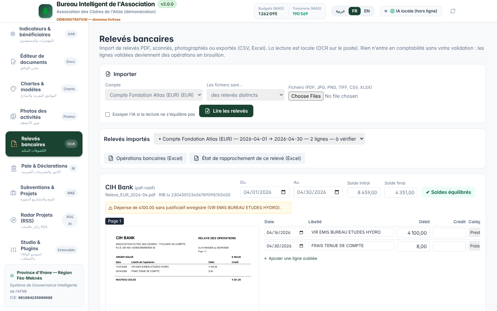
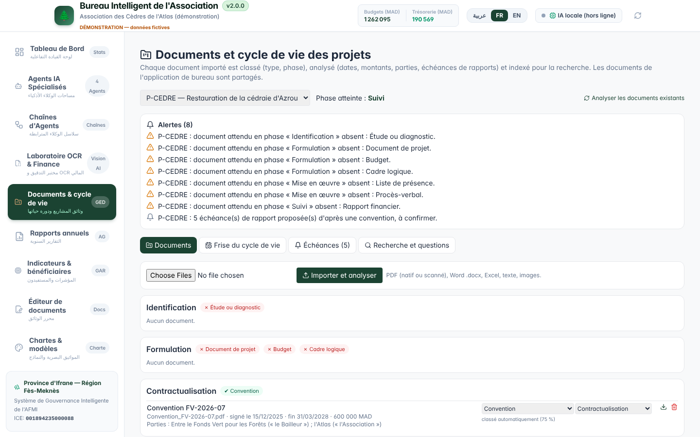
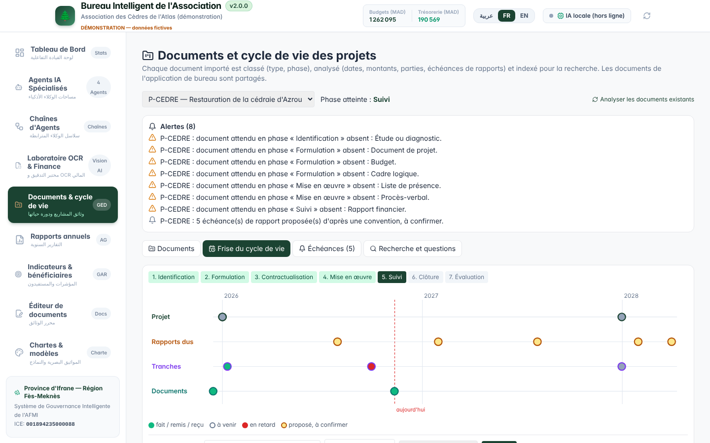
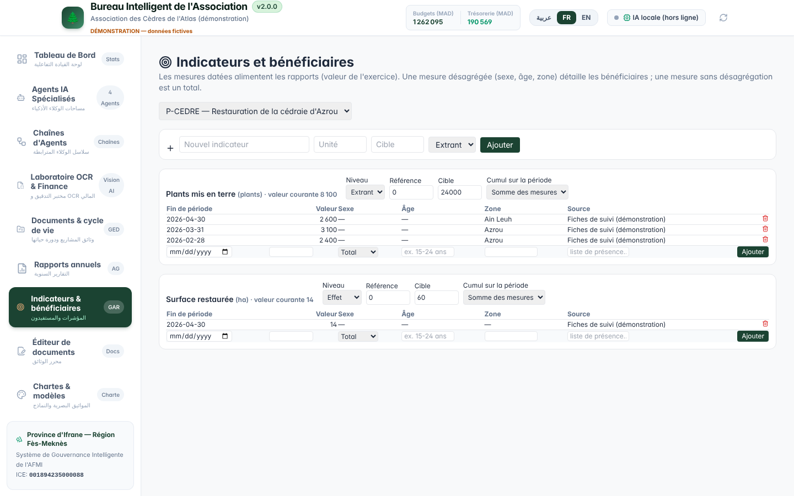
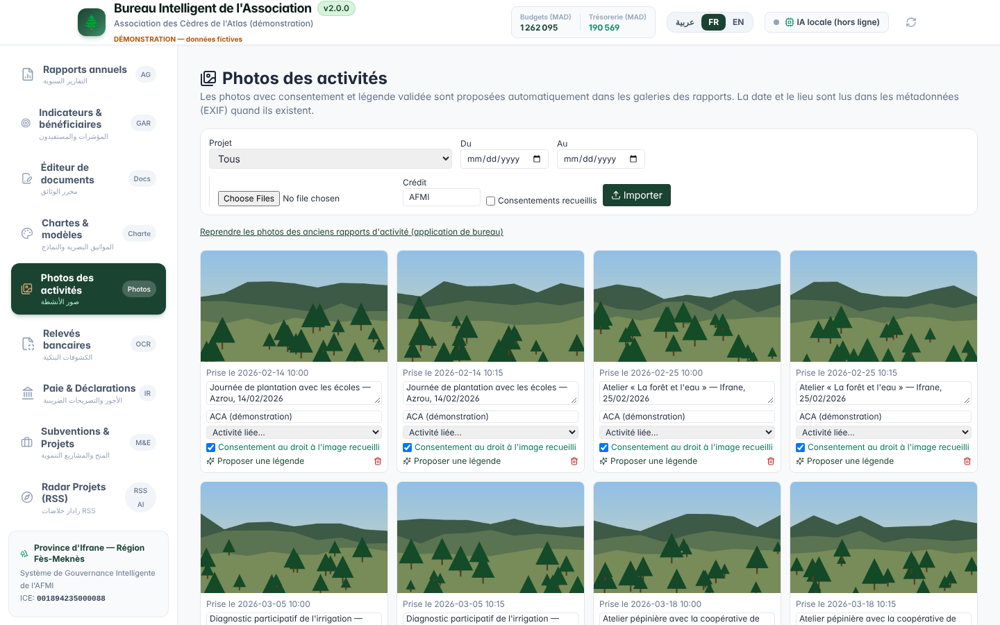
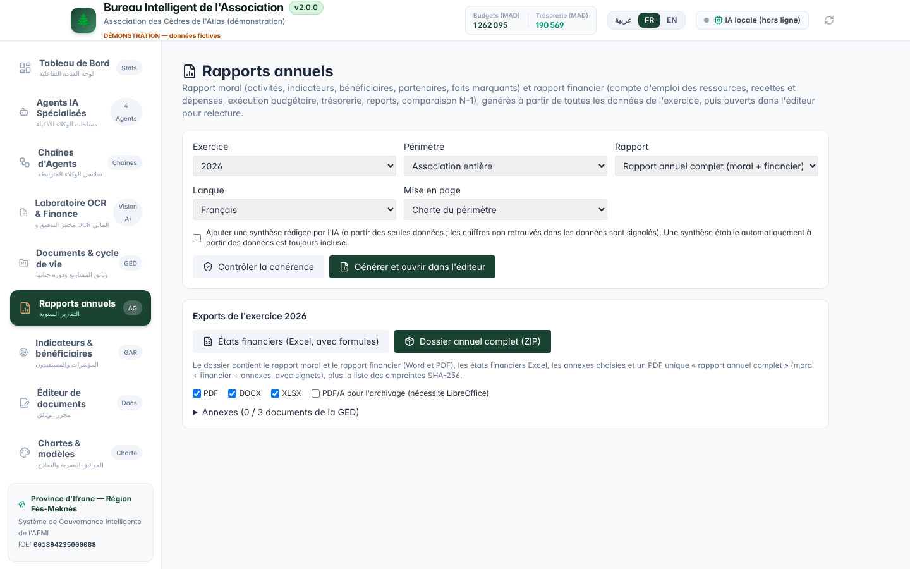
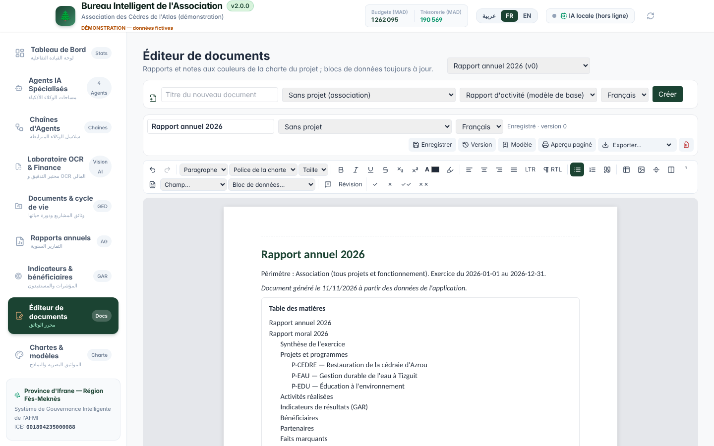
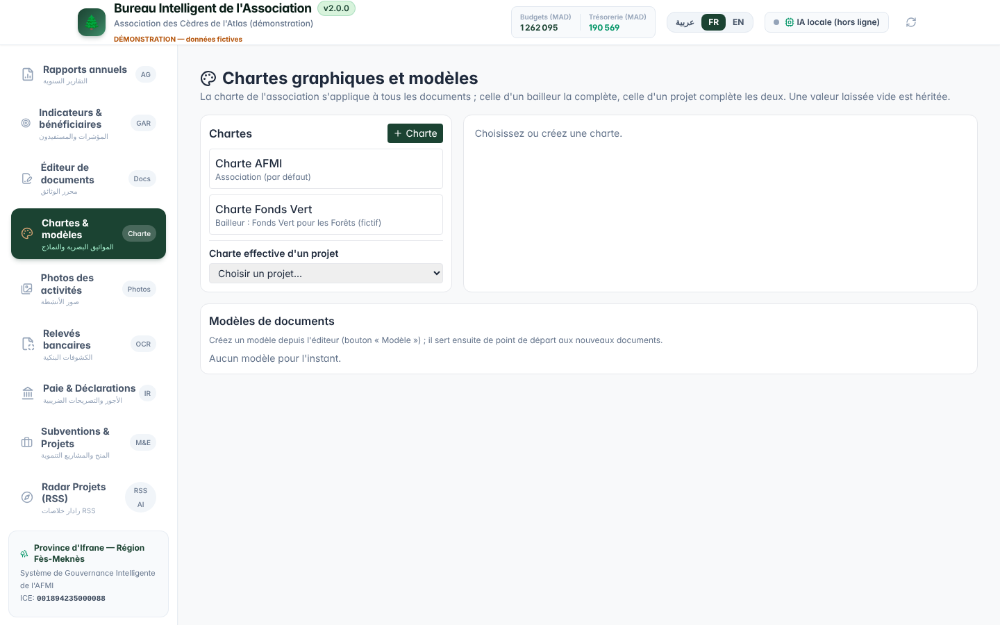

# Guide utilisateur — AFMI Smart Admin 2.0

*Version 2.0.0. Les captures d'écran viennent de la base de **démonstration** : association, projets, comptes et montants
y sont fictifs.*

AFMI Smart Admin réunit en un seul outil la gestion des projets, la trésorerie, les relevés bancaires, les documents,
les rapports et leurs exports. Toutes les données sont enregistrées **sur le poste**, dans une base unique. Rien ne
part sur Internet sans votre accord (voir « Intelligence artificielle »).

L'application a deux parties :
- l'**application de bureau** (Windows) : tableau de bord, portefeuille de projets, bailleurs, **Trésorerie** ;
- le module **Smart Office**, ouvert depuis le menu « 🌲 Smart Office » : relevés, documents, rapports, éditeur,
  paramètres.

Sommaire :
1. Premiers pas
2. Trésorerie et comptes bancaires
3. Relevés bancaires
4. Documents et cycle de vie des projets
5. Indicateurs, activités et photos
6. Rapports annuels
7. Éditeur de documents et chartes graphiques
8. Exports Word, PDF et Excel
9. Paramètres
10. Sauvegardes et sécurité
11. Questions fréquentes

---

## 1. Premiers pas

### Installer
Lancez `AFMI_Smart_Admin_Setup_2.0.0.exe`. L'installation fonctionne sans droits d'administrateur. Elle installe
aussi :
- **Tesseract**, pour la lecture des relevés et documents scannés (français et arabe) ;
- la police arabe **Amiri**, pour les rapports en arabe.

Au premier démarrage d'une base 1.3.0, l'application **sauvegarde la base** puis la met à jour. Vos données sont
conservées.

### Découvrir avec la démonstration
Dans la barre de gauche de l'application de bureau, cliquez sur **🎓 Démonstration**. Une seconde fenêtre s'ouvre,
marquée « DÉMONSTRATION — données fictives ». Elle montre une association fictive avec 3 projets, 3 comptes
bancaires (dont un en euros) et 12 relevés de janvier à avril 2026. Elle contient aussi conventions, budgets,
indicateurs, photos, documents et un rapport annuel.

Vous pouvez y faire tous les essais : **vos vraies données ne sont jamais touchées**. Pour repartir de zéro, cliquez
de nouveau sur « Démonstration » et répondez « Oui » à « remettre à zéro ».

### Les règles de base
- **Une écriture = un compte (ou la caisse) + un projet (ou le fonctionnement) + une ligne budgétaire.** Une dépense
  partagée se ventile sur plusieurs lignes.
- **Rien n'est supprimé définitivement** : une suppression est « logique », l'élément reste dans l'historique.
- **Tout est tracé** : le journal d'audit enregistre qui a fait quoi et quand ; il est protégé contre la
  falsification.
- Les montants sont en **MAD** par défaut. Les comptes en devises sont convertis avec des **taux datés**.

---

## 2. Trésorerie et comptes bancaires

Menu **Trésorerie** de l'application de bureau. Cinq onglets :

| Onglet | Utilité |
|---|---|
| Comptes | Comptes bancaires et caisse (RIB contrôlé), seuil d'alerte de solde, liaison aux projets. |
| Opérations | Saisie, ventilation sur une ou plusieurs lignes budgétaires, validation, virements internes. |
| Budget et conventions | Lignes budgétaires, conventions des bailleurs et tranches, taux de change. |
| Rapprochement | Import de relevés CSV, rapprochement automatique (tolérance de date réglable) ou manuel, état de rapprochement exporté en PDF ou CSV. |
| Prévisions | Trésorerie prévisionnelle mois par mois (tranches attendues, dépenses budgétées). |

Une opération doit être **validée** pour compter dans les états financiers. Une opération en brouillon est signalée
par les contrôles des rapports.

> Selon votre rôle (voir « Paramètres › Utilisateurs »), la Trésorerie peut être en **consultation seule** : un
> bandeau l'indique.

---

## 3. Relevés bancaires

Menu **Relevés bancaires** de Smart Office.

1. Choisissez le **compte**, puis déposez un ou plusieurs relevés : PDF, scan, photo, CSV ou Excel. La lecture se
   fait **sur le poste** (OCR local).
2. Vérifiez le relevé : l'image de la page est à gauche, les lignes lues à droite.
   - Les valeurs incertaines sont surlignées.
   - Le contrôle **« Soldes équilibrés »** confirme que solde initial + mouvements = solde final.
   - Les anomalies sont signalées : dépense sans justificatif, frais inhabituels, dépassement de budget, doublon.
3. Complétez la catégorie, le projet et la ligne budgétaire. L'application apprend de vos corrections et les
   propose ensuite.
4. **Validez** le relevé, puis **intégrez-le** : chaque ligne devient une opération en brouillon, à valider dans la
   Trésorerie.

Les boutons **Opérations bancaires (Excel)** et **État de rapprochement (Excel)** produisent des classeurs avec
formules (voir section 8).

---

## 4. Documents et cycle de vie des projets

Menu **Documents & cycle de vie**. Choisissez un projet.

- **Importer** des documents : conventions, budgets, rapports, procès-verbaux, factures… Chacun est **classé** (type,
  phase) et **analysé** : dates, montants, parties, échéances de rapports. Une convention propose ses **échéances de
  rapport**, avec la phrase d'origine ; vous les confirmez.
- Les **alertes** signalent un rapport en retard ou à remettre, une convention qui arrive à échéance, ou un document
  attendu absent.
- La **frise** résume le projet : phases, rapports dus, tranches, documents.
- **Recherche et questions** : recherche plein texte (accents ignorés) et questions en langage naturel. Chaque
  réponse cite ses sources.

---

## 5. Indicateurs, activités et photos

- **Indicateurs & bénéficiaires** : indicateurs de résultats (extrant, effet, impact), valeur de référence, cible,
  et **mesures datées** par sexe, tranche d'âge et zone. Les rapports annuels cumulent ces mesures.
- **Photos des activités** : importez les photos. Les métadonnées sont lues automatiquement (date, lieu GPS). Saisissez
  la légende, le crédit et le **consentement** : seules les photos avec consentement vont dans les rapports.

---

## 6. Rapports annuels

Menu **Rapports annuels**.

1. Choisissez l'**exercice**, le **périmètre** (association, programme, projet ou bailleur), le type de rapport (moral,
   financier ou complet) et la **langue** (français, arabe ou anglais).
2. **Contrôlez la cohérence**. Les contrôles bloquants (opérations en brouillon, virement incomplet, taux manquant)
   doivent être levés avant de générer le rapport. Les avertissements sont seulement signalés.
3. **Générez** : le rapport s'ouvre dans l'éditeur. Ses tableaux sont calculés depuis les données et restent à jour.
   La synthèse peut être rédigée par l'IA si vous l'autorisez ; tout chiffre que l'IA ajoute et qui n'existe pas
   dans les données est signalé.

La section **Exports** produit les **états financiers Excel** et le **dossier annuel complet** (voir section 8).

> La présentation du compte d'emploi des ressources est provisoire : elle doit être validée par l'expert-comptable de
> l'association.

---

## 7. Éditeur de documents et chartes graphiques

Menu **Éditeur de documents**. C'est un traitement de texte complet :
- styles, tableaux, images, colonnes, notes de bas de page et table des matières ;
- champs automatiques (date, projet, bailleur…) ;
- **blocs de données** : budget, indicateurs, activités, graphiques, galeries de photos, tableaux des rapports ;
- texte de droite à gauche pour l'arabe ;
- commentaires, **mode révision**, versions restaurables ;
- assistant IA pour reformuler, résumer, traduire ou compléter une section.

Les **chartes graphiques** (menu **Chartes & modèles**) définissent les couleurs, polices, logos, en-têtes, pieds de
page et mentions obligatoires. Elles s'héritent : association, puis bailleur, puis projet. Un document prend
automatiquement la charte de son projet.

---

## 8. Exports Word, PDF et Excel

| Où | Export | Contenu |
|---|---|---|
| Éditeur › **Exporter…** | **Word (.docx)** | Fidèle à l'éditeur : styles, table des matières (mise à jour par Word à l'ouverture), vraies notes de bas de page, en-têtes et pieds de page (première page, pages paires et impaires), tableaux, photos, arabe de droite à gauche. |
| Éditeur › **Exporter…** | **PDF** | Qualité impression, polices intégrées, signets tirés des titres. Produit par Microsoft Edge, déjà présent sur Windows. |
| Éditeur › **Exporter…** | **PDF/A** | Archivage à long terme. Nécessite **LibreOffice** (gratuit) sur le poste. |
| Rapports annuels | **États financiers (Excel)** | Une feuille par état, avec de **vraies formules** (sous-totaux, écarts, taux, résultats), le détail des ventilations et une feuille **Contrôles** dont les écarts doivent valoir 0. |
| Rapports annuels | **Dossier annuel complet (ZIP)** | Rapports moral et financier (Word et PDF), états Excel, annexes choisies dans les documents, un **PDF unique** avec signets par partie, et la liste des empreintes de contrôle (SHA-256). |
| Relevés bancaires | **Opérations bancaires**, **État de rapprochement** (Excel) | Une feuille par compte avec solde progressif ; rapprochement avec écart en formule. |

Les noms des fichiers suivent le modèle choisi dans **Paramètres › Exports**, par exemple
`AFMI_RapportFinancier_2026_FR.pdf`. Chaque export est inscrit au journal d'audit.

---

## 9. Paramètres

Menu **Paramètres** de Smart Office. Il est réservé à l'administrateur dès que des utilisateurs sont déclarés.

- **Rechercher** un paramètre par mot-clé.
- **Exporter et importer** les réglages en JSON, par exemple pour configurer un second poste. Les clés d'API ne sont
  jamais exportées. Un import invalide ne modifie rien.
- **Restaurer** la valeur par défaut d'un paramètre, d'une section ou de tout.

| Section | Réglages principaux |
|---|---|
| Association | Nom, sigle, adresse, premier mois de l'exercice, devise, langue des rapports. |
| Comptabilité | Seuil du justificatif obligatoire, apprentissage des règles de classement. |
| Banques | **Tolérance du rapprochement** (3 jours par défaut), seuil des frais inhabituels, gabarits de lecture des relevés. |
| Chartes et modèles | Lien vers l'écran des chartes. |
| Exports | Noms des fichiers, moteur PDF, moteurs détectés sur le poste. |
| Intelligence artificielle | Voir ci-dessous. |
| Notifications | Messagerie (SMTP), e-mail de test, **alertes envoyées automatiquement**, aperçu des alertes en cours. |
| Utilisateurs et rôles | Comptes Windows autorisés : Administrateur, Comptable, Chargé de projet, Lecteur. |
| Sauvegardes | Dossier, fréquence, nombre de sauvegardes conservées, « Sauvegarder maintenant », restauration. |
| Apparence | Langue de l'interface, taille du texte, couleur principale. |
| Rapports et cycle de vie | Niveau de chaque contrôle des rapports, documents attendus par phase. |

### Intelligence artificielle

Par défaut, l'application est en **mode hors ligne** : aucune donnée n'est envoyée à un service d'IA externe. Les
fonctions d'IA utilisent alors Ollama, s'il est installé sur le poste, ou des règles locales.

Pour utiliser une IA en ligne :
1. décochez le mode hors ligne ;
2. pour chaque **tâche** (rédaction, synthèse des rapports, lecture des relevés, questions sur les documents,
   légendes), choisissez le fournisseur : Anthropic, OpenAI, Google Gemini, Mistral, Ollama ou un serveur compatible ;
3. collez la clé d'API, chiffrée sur le poste par Windows, puis **Testez la connexion** ;
4. pour fixer un **plafond de coût mensuel**, saisissez aussi les prix de chaque fournisseur.

Le **masquage** est actif par défaut : RIB, CIN, numéros CNSS et salaires sont remplacés avant tout envoi, et les
images (relevés, factures) ne sont jamais envoyées. Les **prompts système** sont modifiables, avec retour au texte
d'origine.

### Utilisateurs et rôles

| Rôle | Droits |
|---|---|
| Administrateur | Tout, dont les paramètres. |
| Comptable | Trésorerie, relevés, paie, rapports, éditeur et documents. |
| Chargé de projet | Projets, documents, éditeur, indicateurs, photos et rapports ; consultation de la trésorerie. |
| Lecteur | Consultation et exports. |

Tant que la liste est vide, le poste est en mode mono-utilisateur, avec tous les droits. Un compte absent de la liste
n'a qu'un accès en consultation. Les droits s'appliquent à toute l'application, bureau et Smart Office ; ils sont pris
en compte au démarrage suivant de l'application de bureau.

---

## 10. Sauvegardes et sécurité

- **Sauvegardes automatiques** au démarrage, chaque jour ou chaque semaine (réglable). L'application garde les
  30 dernières par défaut. Choisissez de préférence un dossier sur un **disque externe** ou un dossier synchronisé.
- **Restaurer** : choisissez une sauvegarde. La restauration s'applique au **prochain démarrage**, après une sauvegarde
  de sécurité de la base actuelle.
- Chaque mise à jour du schéma de la base est précédée d'une sauvegarde automatique.
- Une sauvegarde qui échoue est signalée par e-mail, si les alertes sont activées.
- Le module Smart Office n'est accessible qu'à l'application elle-même : il est protégé par un jeton de session.
- Les mots de passe et clés d'API sont chiffrés avec votre compte Windows (DPAPI).

---

## 11. Questions fréquentes

**Un relevé scanné est mal lu.** Corrigez les cases surlignées ; le contrôle des soldes vous guide. Avec une IA
autorisée, l'option « Essayer l'IA si la lecture ne s'équilibre pas » peut aider. Une photo nette, de face et bien
éclairée donne les meilleurs résultats.

**Le rapport refuse de se générer.** Un contrôle bloquant est actif. Le plus souvent, ce sont des opérations en
brouillon à valider dans la Trésorerie.

**Le PDF/A n'est pas proposé.** Installez LibreOffice (gratuit), puis réessayez.

**La table des matières du fichier Word n'a pas de numéros de page.** Acceptez la mise à jour proposée par Word à
l'ouverture du fichier, ou appuyez sur F9.

**Je ne peux pas modifier la trésorerie.** Votre rôle ne le permet pas. Demandez à l'administrateur (Paramètres ›
Utilisateurs).

**Comment transférer les réglages sur un autre poste ?** Paramètres › Exporter, puis Importer sur l'autre poste.
Ressaisissez ensuite les clés d'API.
